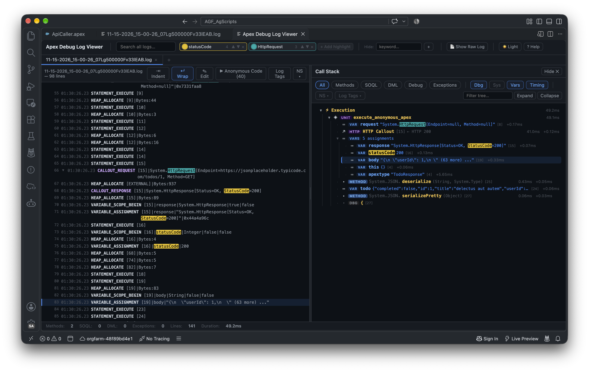

# Apex Debug Log Viewer Guide

Open a downloaded `.log` file and select **Apex Debug Log Viewer** from the editor title bar (or via the command palette).

## Features

- **Call stack tree** — Expandable method blocks with class, method, signature, params, line number, and duration.
- **Virtualized log lines** — Fast rendering of large logs with timestamps, event types, and duration.
- **Filter chips** — All / Methods / SOQL / DML / Debug / Exceptions plus namespace filtering and global search.
- **Source navigation** — Class and method names are colored and Ctrl+clickable to open the source class at the line when source is available under `salesforceAssistBuddy.apexDebugLogViewer.sourcePath`.
- **Highlight slots** — Color-code log lines or tree nodes for easy reference. Each slot has a colored dot that opens the color picker on click.
- **Log Tags modal** — Check tags to filter log entries, then click **Apply** to apply the filter and close the modal.
- **Multi-line log entries** — Continuation lines (e.g., JSON payloads in USER_DEBUG statements) are grouped with their parent event type for correct filtering.
- **Help overlay** — Feature summary and usage notes.
- **Theme toggle** — Click `🌓 Theme` in the header to cycle between `system`, `light`, and `dark` modes.

## Settings

| Setting | Default | Purpose |
| --- | --- | --- |
| `salesforceAssistBuddy.apexDebugLogViewer.sourcePath` | `<workspace>/force-app/main/default/classes` | Path to Apex source folder for source navigation. |
| `salesforceAssistBuddy.logViewer.defaultOpenIn` | `editor` | Where a downloaded log opens when clicked: `editor` or `apexDebugLogViewer`. |
| `salesforceAssistBuddy.apexDebugLogViewer.theme` | `system` | Theme: `system`, `light`, or `dark`. |

## Theme Toggle

Click `🌓 Theme` in the viewer header to cycle between `system` (follows OS), `light`, and `dark` modes independently of your OS theme.

