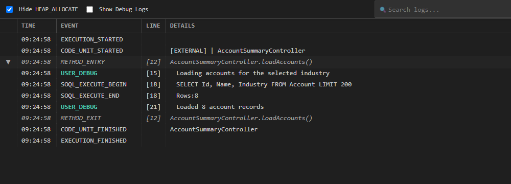

# Log Details — User Guide

Inspect Apex debug log events with expandable method blocks, search, and USER_DEBUG filtering.

## What this tool does

**Log Details** opens a downloaded `.log` file in a dedicated editor webview. It lets you navigate execution events, expand/collapse method blocks, search log content, hide heap-allocation entries, and show only `USER_DEBUG` messages.

## Prerequisites

- A downloaded `.log` file from the Log Viewer
- VS Code 1.100.0 or later

## Step-by-step

### 1. Open Log Details

Clicking a log in the Log Viewer downloads and saves it to the workspace `.logs` directory and opens it in the VS Code editor by default. To open Log Details directly from the editor, select **Log Details** from the editor title bar, or enable the `salesforceAssistBuddy.openLogsInApexLogViewer` setting to make Log Details the default open behavior.

### 2. Navigate execution events

Events are listed in a table with:

- Timestamp
- Event type (method entry/exit, constructor, etc.)
- Line number
- Duration

Click a row to jump to that point in the log.

### 3. Expand or collapse method blocks

Method blocks show nested execution. Expand a block to see child events; collapse it to hide details. This makes it easy to drill into slow or error-prone sections.

### 4. Search log content

Type in the search box to filter events. The search matches across event names, class names, method names, and debug messages.

### 5. Filter by USER_DEBUG

Show only `USER_DEBUG` messages to focus on your custom debug statements. Long debug statements with serialized JSON now wrap in the table, and the full content shows on hover — no more truncated JSON.

### 6. Hide heap-allocation entries

Toggle heap-allocation entries on or off to reduce noise and focus on meaningful execution events.

## Screenshots

---

*Part of Salesforce Assist Buddy for VS Code.*
