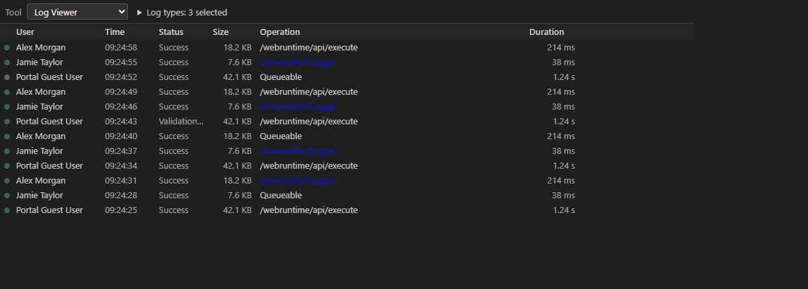

# Log Viewer Guide

The Log Viewer is the default tool in the Salesforce Assist Buddy panel. It helps you browse recent Apex debug logs, filter them, and open individual logs for detailed inspection.

## Opening Log Viewer

Open the **Salesforce Assist Buddy** panel from the VS Code activity bar or command palette. Log Viewer is selected by default.

## Refreshing Logs

- Click **Refresh** to fetch the latest Apex logs from the org.
- Auto-refresh runs while the panel is visible (configurable via `salesforceAssistBuddy.autoRefresh`).
- Refresh interval defaults to 5000 ms (minimum 1000 ms).

## Filtering Logs

- **Log types**: Select exact Operation values (e.g., `UniversalPerfLogger`, `/webruntime/api/execute`, `/aura`). New values are discovered automatically as logs arrive.
- **Current user only**: Limit logs to the connected user.
- **Text search**: Filter logs by user, operation, time, status, size, or duration.

## Opening a Log

Click a log row to download and cache it in the workspace `.logs` directory. By default it opens in the VS Code editor. Set `salesforceAssistBuddy.logViewer.defaultOpenIn` to `apexDebugLogViewer` to open it directly in the Apex Debug Log Viewer.

## Clearing Logs

Use **Clear downloaded logs** to remove cached log files locally. Remote log deletion requires confirmation.

