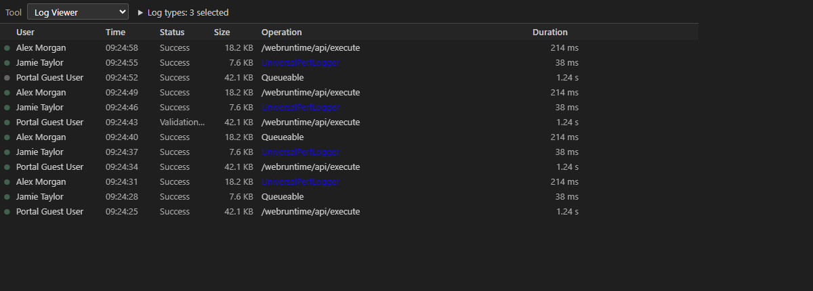

# Log Viewer — User Guide

Browse, filter, and inspect Apex debug logs from authenticated Salesforce orgs directly in VS Code.

## What this tool does

The **Log Viewer** lists recent Apex logs for your connected org, lets you filter and sort them by user, operation, time, status, size, or duration, and opens individual logs in the **VS Code editor** for inspection.

## Prerequisites

- An authenticated Salesforce org via the Salesforce CLI (`sf org login ...`)
- VS Code 1.100.0 or later

## Step-by-step

### 1. Open the Log Viewer

Open the **Salesforce Assist Buddy** panel from the VS Code activity bar. The Log Viewer opens by default and lists the latest Apex logs for your configured target org.

### 2. Refresh logs

Click **Refresh** to pull the latest logs from the org. Logs are also refreshed automatically when the panel is visible if auto-refresh is enabled (default: every 5000 ms).

### 3. Filter by user

Restrict results to the connected user only, or include other users. This helps you focus on your own debug logs or investigate issues for another user like **bill**.

### 4. Filter by log type

Select one or more **Log types** (Operation values) beside the tool selector. Starter options include:

- `UniversalPerfLogger`
- `/webruntime/api/execute`
- `/aura`
- Common Apex operations

New Operation values are added automatically as logs arrive and are remembered per workspace. **All types** includes future types automatically; explicit selections do not.

### 5. Sort

Click column headers to sort by user, operation, time, status, size, or duration. Column widths are saved and restored across reloads.

### 6. Open a log

Click a log to download and cache it in the workspace `.logs` directory. The log opens in the VS Code editor for inspection.

### 7. Clean up

- Clear downloaded files locally from the `.logs` directory
- Delete remote Apex logs after confirmation to free org storage

## Screenshots

---

*Part of Salesforce Assist Buddy for VS Code.*
