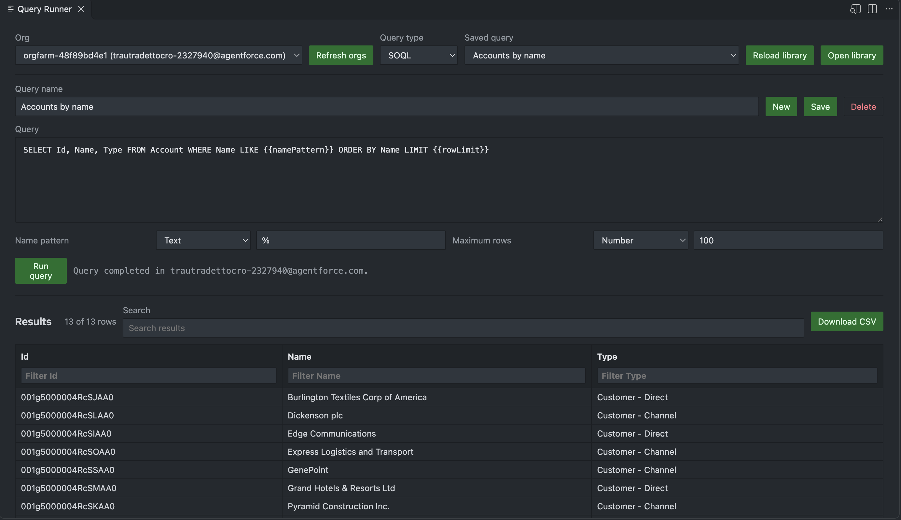
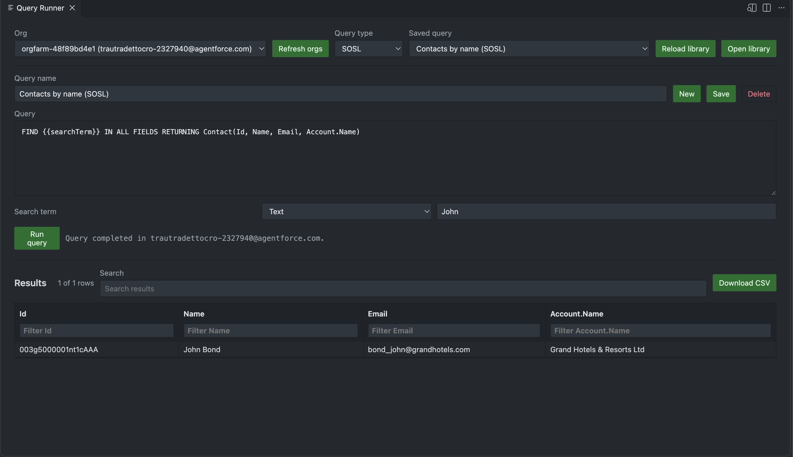

# Query Runner Guide

The Query Runner (formerly SOQL Query Runner) lets you run parameterized SOQL and SOSL queries against authenticated Salesforce orgs and export results as CSV.

## Opening Query Runner

Select **Query Runner** in the panel's tool selector. It opens in a separate editor.

## Query Types

Use the query type dropdown to switch between:

- **SOQL** — Standard Salesforce Object Query Language queries.
- **SOSL** — Salesforce Object Search Language searches across multiple objects.

## Saved Queries

Queries are stored under `.sfdx/salesforce-assist-buddy/queries.json` (or `.sf/salesforce-assist-buddy/queries.json`). Each saved query now includes a `type` field (`soql` or `sosl`) so the type is preserved across sessions.

The file is created with example queries the first time the editor opens:
- An Accounts SOQL example
- A Contacts SOSL example

Use **Open library** to edit queries directly and **Reload library** to refresh.

## Parameters

Query parameters use `{{parameterName}}` placeholders. Matching input controls appear in the editor:
- Text parameters can replace a complete literal (`Name = {{name}}`)
- Or appear inside quotes (`Name LIKE '%{{brandName}}%'`)
- For SOSL queries, the search term is used directly in the FIND clause

## Results

Results are shown in a sortable table with global search and per-column filters. Use **Download CSV** to export the complete result set.

