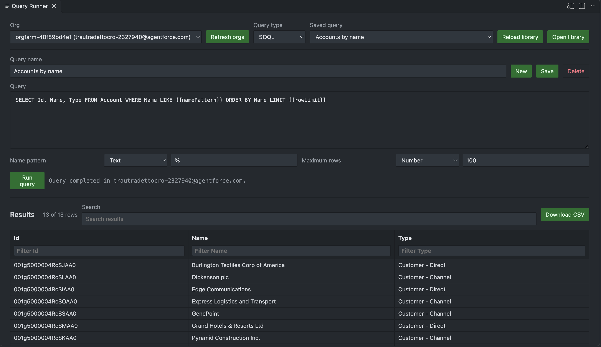
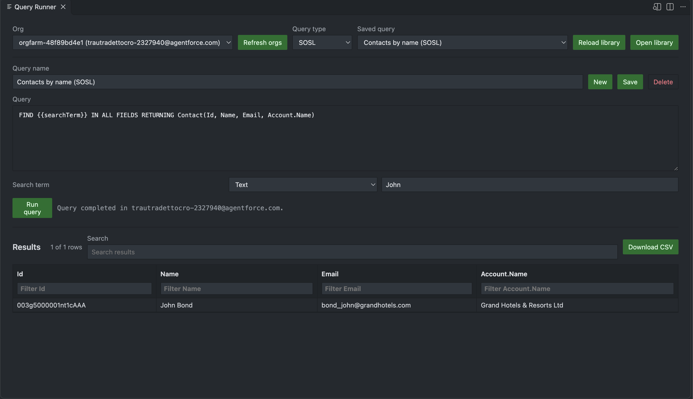

# Query Runner — User Guide

Run saved SOQL and SOSL queries with parameters across authenticated Salesforce orgs.

## What this tool does

The **Query Runner** (formerly SOQL Query Runner) lets you select an authenticated org, run saved SOQL or SOSL queries with parameters, and export searchable results as CSV.

## Prerequisites

- Authenticated Salesforce CLI orgs
- VS Code 1.100.0 or later

## Step-by-step

### 1. Open Query Runner

Select **Query Runner** in the panel's tool selector to open a separate editor. It lists authenticated orgs from Salesforce CLI and defaults to the CLI-selected org when available.

### 2. Choose a query type

Use the dropdown to switch between **SOQL** and **SOSL** queries.

- **SOQL**: `SELECT Id, Name FROM Account WHERE Name LIKE '%{{brandName}}%' LIMIT 10`
- **SOSL**: `FIND {{searchTerm}} IN ALL FIELDS RETURNING Account(Id, Name), Contact(Id, Email)`

The query type (SOQL/SOSL) is stored in the JSON library, so existing SOQL queries continue to work unchanged.

### 3. Use query parameters

Parameters use `{{parameterName}}` placeholders and are defined with a type in the saved query JSON. Matching input controls appear in the editor.

- Text parameters can replace a complete literal: `Name = {{name}}`
- Or appear inside quotes: `Name LIKE '%{{brandName}}%'`
- For SOSL queries, the search term is used directly in the FIND clause

### 4. Run the query

Select an org and click **Run**. Results are shown in a sortable table with:

- Global search
- Per-column filters
- Column sorting

### 5. Export results

Click **Download CSV** to export the complete result set. The export filename is `query-results-*.csv`.

### 6. Manage saved queries

Saved queries are stored under:

- `.sfdx/salesforce-assist-buddy/queries.json` (when `.sfdx` exists)
- `.sf/salesforce-assist-buddy/queries.json` (when only `.sf` exists)

The file is created with an Accounts example and a Contacts SOSL example the first time the editor opens. Use **Open library** to edit it directly and **Reload library** to refresh the list.

## Screenshots

---

*Part of Salesforce Assist Buddy for VS Code.*
